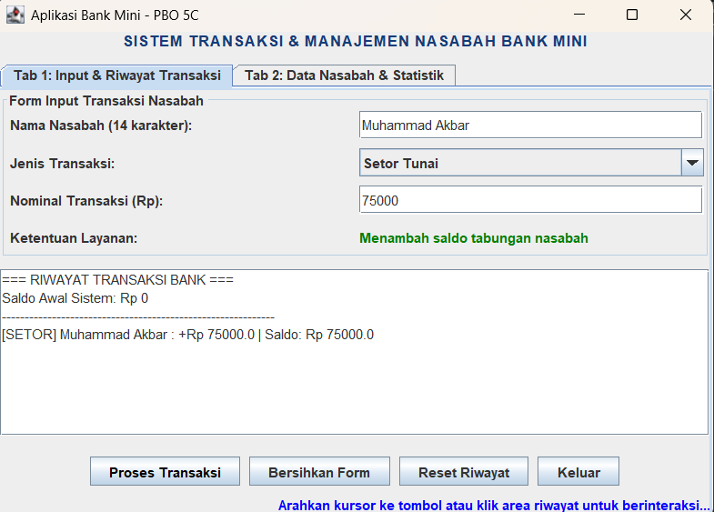
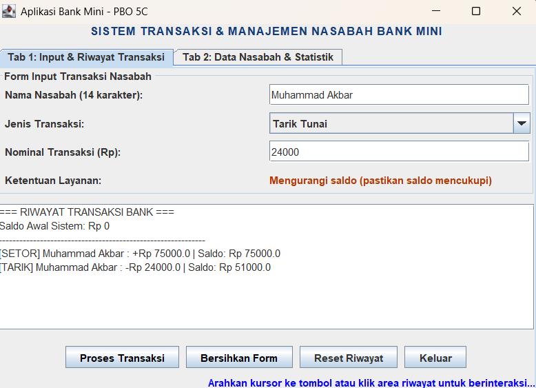
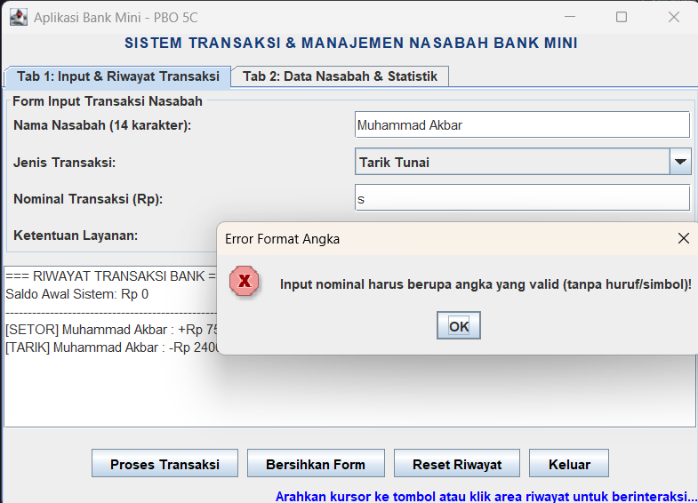
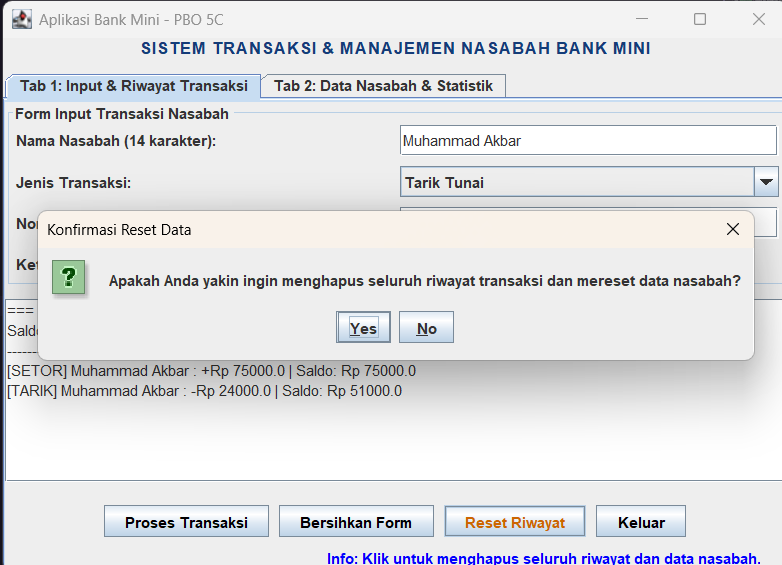
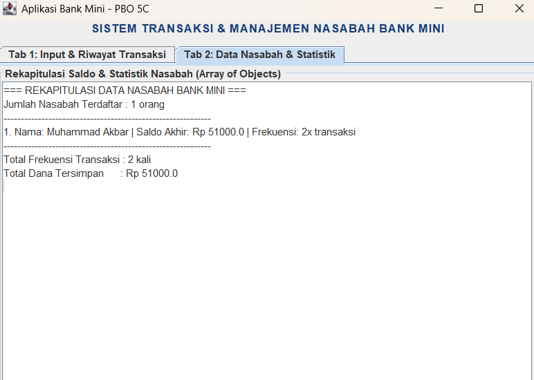

# Tugas GUI Pemrograman Berorientasi Objek - Aplikasi Bank Mini

Repositori ini berisi implementasi program **Graphical User Interface (GUI)** berbasis **Java Swing (`javax.swing.*`)** dan **AWT (`java.awt.*` & `java.awt.event.*`)** yang dirancang untuk memenuhi penugasan mata kuliah **Pemrograman Berorientasi Objek (Kelas 5C)**, Universitas Mataram.

Program mengintegrasikan konsep OOP perbankan (*Encapsulation*, *Array of Objects*, *Separation of Concerns*) dengan 5 pilar utama arsitektur GUI Java: **Top-level Container Class**, **Intermediate Container Class**, **Atomic Component Class**, **Layout Classes**, dan **Event Handling** (kombinasi *Event Listener Interfaces* dan *Event Adapter Class*).

---

## Identitas Mahasiswa

- **Nama:** Muhammad Akbar
- **NIM:** F1D02410075
- **Kelas:** 5C
- **Program Studi:** S1 Teknik Informatika
- **Fakultas / Universitas:** Fakultas Teknik, Universitas Mataram

---

## Deskripsi Program

**Aplikasi Bank Mini** adalah aplikasi desktop simulasi perbankan yang memungkinkan pengguna melakukan transaksi finansial (*Setor Tunai* dan *Tarik Tunai*) serta mengelola data nasabah secara dinamis menggunakan **Array of Objects (`Nasabah[]`)**.

Antarmuka pengguna dibagi menjadi dua tab utama menggunakan `JTabbedPane`:
1. **Tab 1 (Input & Riwayat Transaksi):** Formulir pengisian transaksi perbankan (Nama Nasabah, Jenis Transaksi, Nominal) dilengkapi tombol eksekusi, pembersihan form, reset data, tombol keluar, serta area teks riwayat transaksi yang mencatat mutasi saldo secara kronologis.
2. **Tab 2 (Data Nasabah & Statistik):** Rekapitulasi agregat seluruh nasabah yang tersimpan di dalam *Array of Objects*, mencakup jumlah nasabah terdaftar, rincian saldo akhir tiap nasabah, frekuensi transaksi masing-masing nasabah, total frekuensi transaksi bank, dan total dana tersimpan.

---

## Struktur Proyek (Arsitektur OOP)

Proyek ini dibangun secara terstruktur menjadi 3 file kode sumber Java (`.java`):

```text
tugas-pbo-bank-gui/
├── README.md                      # Dokumentasi utama repositori (root)
├── desc.md                        # Deskripsi ringkas proyek
└── javaproject/
    ├── README.md                  # Dokumentasi internal folder proyek
    ├── desc.md
    ├── ss1.png ~ ss5.png          # Berkas dokumentasi screenshot antarmuka
    └── src/
        ├── Nasabah.java           # Model/Entity Class (Encapsulation data nasabah)
        ├── AplikasiBankMini.java  # GUI Builder, Layouting, Array of Objects, & Event Handling
        └── Main.java              # Driver class (Entry point aplikasi)
```

1. **`Nasabah.java`:** Kelas entitas/model yang menerapkan prinsip *Encapsulation* dengan atribut `private` (`nama`, `saldo`, `jumlahTransaksi`), *getter/setter*, serta metode bisnis perbankan seperti `setorTunai(double nominal)`, `tarikTunai(double nominal)` yang dilengkapi validasi kecukupan saldo, dan `resetData()`.
2. **`AplikasiBankMini.java`:** Kelas utama GUI yang membangun antarmuka visual, mengelola koleksi *Array of Objects* (`Nasabah[] daftarNasabah`), mengatur hierarki kontainer dan *Layout Manager*, serta menangani interaksi pengguna melalui implementasi 4 *Event Listener Interfaces* dan 1 *Event Adapter Class*.
3. **`Main.java`:** Kelas eksekutabel (*driver class*) yang berisi metode `main` untuk menginisialisasi objek `AplikasiBankMini` dan menjalankan `launchFrame()`.

---

## Pemetaan 5 Komponen Utama GUI Java Swing

Berikut adalah rincian lengkap 5 komponen utama GUI yang diimplementasikan pada kode program `AplikasiBankMini.java`:

### 1. Top-Level Container Class
Kontainer tingkat tertinggi yang berdiri sendiri dan berfungsi sebagai jendela induk bagi seluruh komponen visual:
- **`JFrame` (`frame`):**
  - Berfungsi sebagai jendela utama aplikasi.
  - Diberi judul `"Aplikasi Bank Mini - PBO 5C"`.
  - Diatur menggunakan `frame.setDefaultCloseOperation(JFrame.DO_NOTHING_ON_CLOSE)` agar penutupan jendela dicegat dan didelegasikan ke dialog konfirmasi `WindowAdapter`.
  - Menggunakan *Content Pane* (`frame.getContentPane()`) untuk menampung komponen judul dan tab navigasi dengan ukuran dinamis (`pack()`) dan posisi tengah layar (`setLocationRelativeTo(null)`).
- **`JOptionPane` (Dialog Class):**
  - Menampilkan jendela pop-up/dialog modal yang terikat pada `frame` utama.
  - `JOptionPane.showConfirmDialog()`: Digunakan untuk konfirmasi keluar saat tombol close (`X`) atau tombol `btnKeluar` diklik, serta saat mereset seluruh riwayat/data nasabah (`YES_NO_OPTION`).
  - `JOptionPane.showMessageDialog()`: Digunakan untuk memberikan umpan balik pengguna berupa pesan peringatan form kosong (`WARNING_MESSAGE`), pesan error nominal tidak valid atau saldo tidak mencukupi (`ERROR_MESSAGE`), serta pesan informasi berhasil reset (`INFORMATION_MESSAGE`).

### 2. Intermediate Container Class
Kontainer perantara yang berada di dalam *Top-Level Container* untuk mengelompokkan dan menstrukturkan komponen:
- **`JTabbedPane` (`tabPane`):** Kontainer tab yang membagi tampilan menjadi dua panel independen (*Tab 1: Input & Riwayat Transaksi* dan *Tab 2: Data Nasabah & Statistik*).
- **`JPanel` (`panelTabTransaksi`, `panelTabStatistik`, `panelForm`, `panelTombol`):**
  - `panelTabTransaksi` & `panelTabStatistik`: Panel utama untuk masing-masing tab dengan `BorderLayout`.
  - `panelForm`: Panel khusus form input dengan garis batas judul (*TitledBorder*).
  - `panelTombol`: Panel khusus barisan tombol aksi dengan perataan tengah.
- **`JScrollPane` (`scrollRiwayat`, `scrollStatistik`):** Kontainer pembungkus `JTextArea` untuk memberikan fasilitas pengguliran (*scrolling*) horizontal dan vertikal secara otomatis saat log transaksi atau daftar nasabah bertambah panjang.
- **`Box` (`panelBawah`):** Kontainer perantara bawaan Swing yang menerapkan `BoxLayout` dengan orientasi sumbu Y (`BoxLayout.Y_AXIS`) untuk menyusun `panelTombol` dan `lblStatusMouse` secara vertikal.

### 3. Atomic Component Class
Komponen kontrol visual individu tempat pengguna berinteraksi langsung:
- **`JLabel` (`lblJudul`, `lblNama`, `lblJenis`, `lblNominal`, `lblTitleInfo`, `lblInfoJenis`, `lblStatusMouse`):** Menampilkan teks statis dan dinamis, seperti judul utama berseri tebal, label input form, indikator jenis layanan, status koordinat mouse, serta penghitung panjang karakter nama secara *real-time*.
- **`JTextField` (`tfNama`, `tfNominal`):** Komponen input teks satu baris untuk memasukkan nama nasabah dan nominal uang transaksi.
- **`JComboBox<String>` (`cbJenisTransaksi`):** Menu dropdown untuk memilih tipe transaksi (`"Setor Tunai"` atau `"Tarik Tunai"`).
- **`JButton` (`btnProses`, `btnBersihkanForm`, `btnReset`, `btnKeluar`):** Tombol klik untuk memicu aksi pemrosesan transaksi, pengosongan form, peresetan data, dan keluar aplikasi.
- **`JTextArea` (`taRiwayat`, `taStatistik`):** Komponen teks multi-baris yang diatur ke mode baca-saja (`setEditable(false)`) untuk menampilkan rekam jejak transaksi dan rekapitulasi data nasabah.

### 4. Layout Classes (Layout Manager)
Pengatur susunan, ukuran, dan posisi komponen visual di dalam kontainer:
- **`BorderLayout` (`java.awt.BorderLayout`):**
  - Diterapkan pada `Content Pane` milik `JFrame` (`NORTH` untuk label judul, `CENTER` untuk `tabPane`).
  - Diterapkan pada `panelTabTransaksi` (`NORTH` untuk `panelForm`, `CENTER` untuk `scrollRiwayat`, `SOUTH` untuk `panelBawah`).
  - Diterapkan pada `panelTabStatistik` (`CENTER` untuk `scrollStatistik`).
- **`GridLayout` (`java.awt.GridLayout`):**
  - Diterapkan pada `panelForm` dengan konfigurasi `GridLayout(4, 2, 8, 8)` untuk membagi formulir input menjadi 4 baris dan 2 kolom berukuran seragam dengan jarak horizontal dan vertikal 8 piksel.
- **`FlowLayout` (`java.awt.FlowLayout`):**
  - Diterapkan pada `panelTombol` dengan konfigurasi `FlowLayout(FlowLayout.CENTER, 8, 8)` agar keempat tombol tersusun sejajar secara horizontal di tengah.
- **`BoxLayout` (`javax.swing.BoxLayout`):**
  - Diterapkan pada kontainer `Box` (`panelBawah`) dengan orientasi `BoxLayout.Y_AXIS` untuk menata `panelTombol` dan `lblStatusMouse` secara vertikal dari atas ke bawah.

### 5. Event Listener (Interfaces & Adapter Class)
Program ini menerapkan pola *Delegation Event Model* (`java.awt.event.*`) dengan mengombinasikan **4 Listener Interfaces** dan **1 Adapter Class**:

#### A. Event Listener Interfaces (Implementasi Multi-Interface)
1. **`ActionListener`:**
   - Meng-`@Override` metode `actionPerformed(ActionEvent e)`.
   - Menangani event penekanan tombol `btnProses`, `btnBersihkanForm`, `btnReset`, `btnKeluar`, serta event penekanan tombol `<Enter>` pada kolom `tfNominal`.
2. **`MouseListener`:**
   - Meng-`@Override` 5 metode: `mouseEntered`, `mouseExited`, `mouseClicked`, `mousePressed`, dan `mouseReleased`.
   - Memberikan efek visual perubahan warna tombol saat mouse masuk/keluar (*hover effect*), menampilkan petunjuk fungsi tombol pada `lblStatusMouse`, dan menangkap koordinat posisi klik X dan Y pada `taRiwayat`.
3. **`ItemListener`:**
   - Meng-`@Override` metode `itemStateChanged(ItemEvent e)`.
   - Mendeteksi pemilihan opsi pada dropdown `cbJenisTransaksi` dan memperbarui teks deskripsi ketentuan serta warna indikator pada `lblInfoJenis` secara langsung.
4. **`KeyListener`:**
   - Meng-`@Override` 3 metode: `keyReleased`, `keyTyped`, dan `keyPressed`.
   - Pada `keyReleased`, mendeteksi setiap ketikan huruf pada `tfNama` dan menghitung jumlah karakter secara langsung pada label nama.

#### B. Event Adapter Class
- **`WindowAdapter`:**
  - Diimplementasikan melalui *inner class* `WindowCloseHandler extends WindowAdapter`.
  - Meng-`@Override` metode `windowClosing(WindowEvent e)` untuk mencegat aksi penutupan jendela saat pengguna mengklik tombol Close (`X`) pada pojok kanan atas `JFrame`.
  - Menampilkan dialog konfirmasi `JOptionPane.showConfirmDialog` bertipe `YES_NO_OPTION`. Jika pengguna memilih `YES_OPTION`, aplikasi ditutup (`System.exit(0)`). Jika memilih `NO_OPTION`, aplikasi tetap berjalan karena penutupan awal telah dicegah oleh `JFrame.DO_NOTHING_ON_CLOSE`.

---

## Tabel Ringkasan Pemenuhan Syarat Tugas

| No | Komponen Utama GUI | Syarat Minimal | Kelas / Interface yang Diimplementasikan pada Proyek |
|:--:|:---|:---:|:---|
| 1 | **Top-Level Container Class** | Minimal 1 | `JFrame` & `JOptionPane` |
| 2 | **Intermediate Container Class** | Minimal 1 | `JTabbedPane`, `JPanel`, `JScrollPane`, `Box` |
| 3 | **Atomic Component Class** | Minimal 1 | `JLabel`, `JTextField`, `JComboBox`, `JButton`, `JTextArea` |
| 4 | **Layout Classes** | Minimal 2 | `BorderLayout`, `GridLayout`, `FlowLayout`, `BoxLayout` |
| 5 | **Event Listener** | Interfaces / Adapter | **Interfaces:** `ActionListener`, `MouseListener`, `ItemListener`, `KeyListener`<br>**Adapter:** `WindowAdapter` (`WindowCloseHandler`) |

---

## Dokumentasi Tampilan Program (Screenshots)

Berikut adalah tangkapan layar antarmuka aplikasi saat dioperasikan:

### 1. Tab 1 - Tampilan Awal & Transaksi Setor Tunai
Menampilkan form input transaksi, dropdown jenis transaksi, dan riwayat setoran awal nasabah.



---

### 2. Tab 1 - Transaksi Tarik Tunai & Validasi Saldo
Menampilkan transaksi penarikan saldo dan penyesuaian saldo akhir nasabah pada riwayat mutasi.



---

### 3. Validasi Error Input Melalui `JOptionPane`
Menampilkan dialog error ketika pengguna menginputkan nominal bukan berupa angka atau data kosong.



---

### 4. Dialog Konfirmasi Dialog `JOptionPane` (Reset / Keluar)
Menampilkan jendela konfirmasi interaktif bertipe *Yes/No* sebelum operasi kritis dijalankan.



---

### 5. Tab 2 - Rekapitulasi Data Nasabah & Statistik (*Array of Objects*)
Menampilkan agregasi data nasabah per orang, total frekuensi transaksi bank, serta total saldo keseluruhan yang tersimpan.



---

## Panduan Kompilasi dan Eksekusi Program

### Prasyarat
- Java Development Kit (JDK) versi 8 atau yang lebih baru telah terpasang.
- Perintah `javac` dan `java` dapat diakses melalui Terminal / Command Prompt.

### 1. Kompilasi Kode Sumber
Buka Terminal atau Command Prompt di direktori root repositori, lalu jalankan:

```bash
cd javaproject/src
javac *.java
```

### 2. Menjalankan Aplikasi
Jalankan program melalui kelas driver `Main`:

```bash
java Main
```

Atau jika dijalankan langsung dari root repositori:

```bash
javac javaproject/src/*.java
java -cp javaproject/src Main
```
