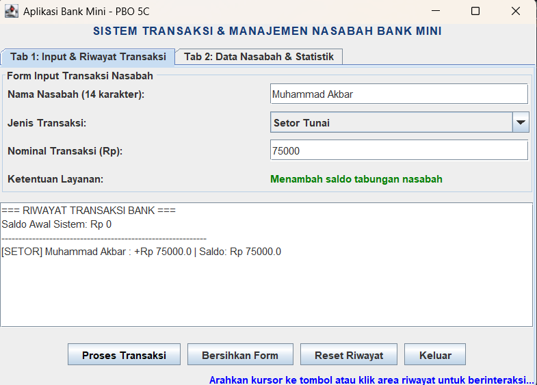
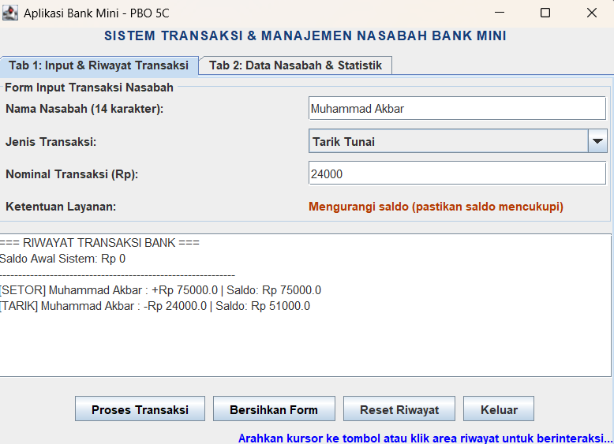
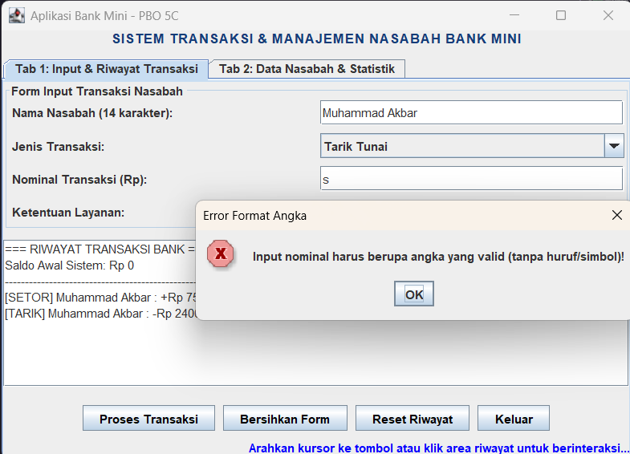
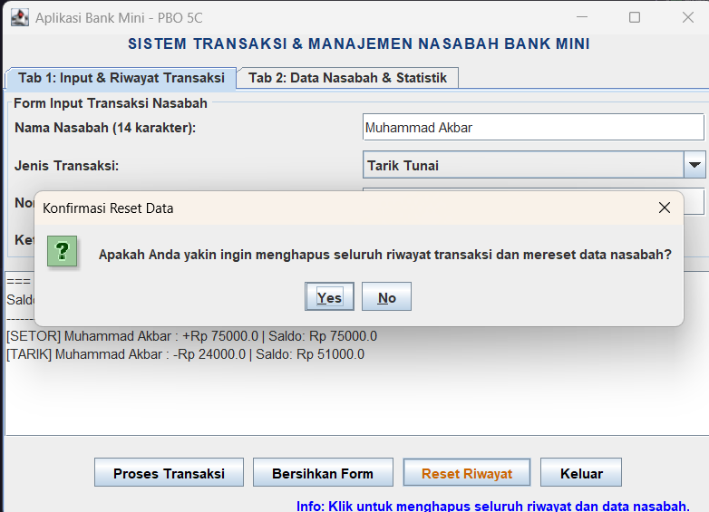
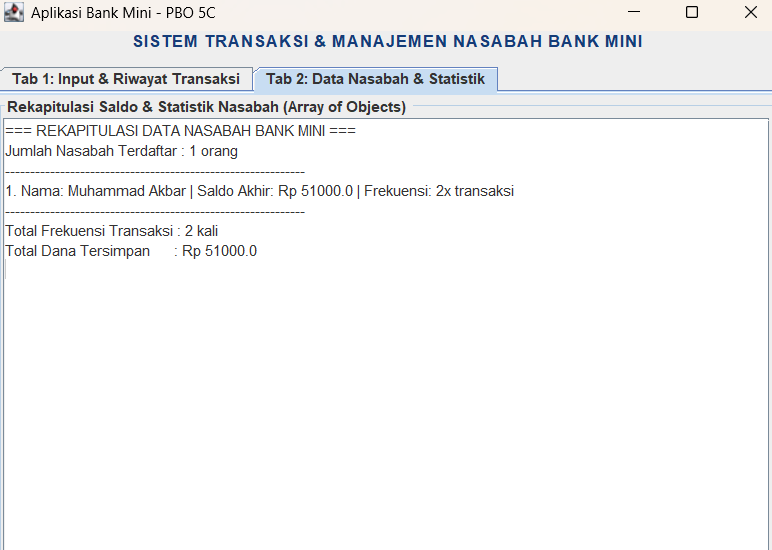

# Tugas GUI Pemrograman Berorientasi Objek - Aplikasi Bank Mini

Repositori ini berisi implementasi program **Graphical User Interface (GUI)** menggunakan pustaka **Java Swing (`javax.swing.*`)** dan **AWT (`java.awt.*` & `java.awt.event.*`)** untuk memenuhi tugas mata kuliah Pemrograman Berorientasi Objek (Pertemuan 10).

## Identitas Mahasiswa

- **Nama:** Muhammad Akbar
- **NIM:** F1D02410075
- **Kelas:** 5C
- **Program Studi:** Teknik Informatika - Universitas Mataram

---

## Deskripsi Program

**Aplikasi Bank Mini** adalah aplikasi desktop berbasis GUI Java Swing yang mensimulasikan layanan transaksi perbankan (Setor Tunai dan Tarik Tunai) serta manajemen data banyak nasabah menggunakan konsep **Array of Objects (`Nasabah[]`)**. Aplikasi ini memisahkan tampilan menjadi dua halaman tab utama:

1. **Tab 1 (Input & Riwayat Transaksi):** Digunakan untuk menginput transaksi nasabah dan mencatat log transaksi secara kronologis.
2. **Tab 2 (Data Nasabah & Statistik):** Menampilkan rekapitulasi saldo akhir setiap nasabah, frekuensi transaksi per nasabah, dan total dana keseluruhan yang tersimpan di bank.

---

## Struktur Proyek (Konsep OOP)

Program dirancang secara modular ke dalam 3 file kelas terpisah sesuai prinsip _Object-Oriented Programming_ (_Encapsulation_, _Array of Objects_, _Separation of Concerns_, dan _Multiple Interface Implementation_):

- `Nasabah.java` — Kelas model/entitas dengan atribut `private` (`nama`, `saldo`, `jumlahTransaksi`) serta _method_ bisnis untuk memproses setor tunai (`setorTunai`), tarik tunai dengan validasi kecukupan saldo (`tarikTunai`), dan peresetan data (`resetData`).
- `AplikasiBankMini.java` — Kelas pembangun antarmuka GUI, pengelola _Array of Objects_ (`daftarNasabah`), pengatur tata letak (_Layout Manager_), sekaligus penangan kejadian (_Event Handler_) yang mengimplementasikan 4 _interface listener_.
- `Main.java` — Kelas _driver_ yang berisi _method_ `main` untuk menginstansiasi objek `AplikasiBankMini` dan memanggil _method_ `launchFrame()`.

---

## Pemenuhan Syarat Komponen GUI & Event Handling

Berdasarkan ketentuan tugas dan materi perkuliahan Pertemuan 10, berikut adalah rincian komponen yang diimplementasikan di dalam kode:

### 1. Top-Level Container

Container dasar tempat seluruh komponen visual lainnya diletakkan:

- **`JFrame` (`frame`):** Jendela utama aplikasi yang dikonfigurasi dengan `JFrame.EXIT_ON_CLOSE` agar eksekusi program dihentikan sepenuhnya dan dihapus dari memori saat tombol _close_ (X) ditekan. Sesuai kaidah Java Swing, pengaturan _layout_ dan penambahan komponen tidak dilakukan langsung ke `JFrame`, melainkan melalui _Content Pane_ (`frame.getContentPane().setLayout(...)` dan `frame.getContentPane().add(...)`).
- **`JOptionPane` (Dialog):** Digunakan untuk menampilkan jendela dialog interaktif yang terikat pada `frame` utama (_parent_), meliputi:
  - `showConfirmDialog` dengan variasi tombol `YES_NO_OPTION` (konfirmasi reset data) dan `OK_CANCEL_OPTION` (konfirmasi keluar aplikasi) serta ikon `QUESTION_MESSAGE`.
  - `showMessageDialog` dengan variasi ikon `WARNING_MESSAGE` (peringatan form kosong), `ERROR_MESSAGE` (validasi input bukan angka, nominal tidak valid, atau saldo kurang), dan `INFORMATION_MESSAGE` (notifikasi berhasil reset).

### 2. Intermediate Component (Container)

Container perantara yang berfungsi mengelompokkan komponen-komponen lain agar terstruktur rapi:

- **`JTabbedPane` (`tabPane`):** Kontainer bertab yang menerapkan konsep tumpukan halaman untuk memisahkan **Tab 1: Input & Riwayat Transaksi** dan **Tab 2: Data Nasabah & Statistik**.
- **`JPanel` (`panelTabTransaksi`, `panelForm`, `panelTombol`, `panelTabStatistik`):** Kontainer perantara untuk mengelompokkan area formulir input (dilengkapi _TitledBorder_), barisan tombol aksi, dan halaman statistik nasabah.
- **`JScrollPane` (`scrollRiwayat`, `scrollStatistik`):** Membungkus komponen `JTextArea` pada Tab 1 dan Tab 2 agar memiliki penggulung (_scroll bar_) otomatis ketika daftar transaksi atau daftar nasabah melebihi area tampilan.
- **`Box` (`panelBawah`):** Kontainer perantara yang secara internal menerapkan `BoxLayout` (`BoxLayout.Y_AXIS`) untuk menyusun `panelTombol` dan `lblStatusMouse` secara berurutan dari atas ke bawah.

### 3. Atomic Component

Komponen spesifik tempat pengguna berinteraksi secara langsung:

- **`JLabel` (`lblJudul`, `lblNama`, `lblJenis`, `lblNominal`, `lblTitleInfo`, `lblInfoJenis`, `lblStatusMouse`):** Menampilkan judul aplikasi (diatur hurufnya menggunakan `setFont` dan `setForeground`), label instruksi form, penghitung jumlah karakter nama secara _real-time_, keterangan jenis layanan, serta informasi status mouse.
- **`JTextField` (`tfNama`, `tfNominal`):** Menerima masukan teks satu baris dari pengguna berupa Nama Nasabah dan Nominal Transaksi.
- **`JComboBox` (`cbJenisTransaksi`):** Menyediakan menu pilihan (_dropdown_) jenis transaksi (`"Setor Tunai"` dan `"Tarik Tunai"`).
- **`JButton` (`btnProses`, `btnBersihkanForm`, `btnReset`, `btnKeluar`):** Empat tombol interaktif untuk memproses transaksi, membersihkan kolom input form, mereset seluruh riwayat/data nasabah, dan menutup aplikasi.
- **`JTextArea` (`taRiwayat`, `taStatistik`):** Area teks multi-baris (dikonfigurasi `setEditable(false)`) untuk menampilkan catatan log transaksi pada Tab 1 dan laporan statistik _Array of Objects_ nasabah pada Tab 2.

### 4. Layout Manager

Pengatur tata letak dan posisi komponen di dalam container (`java.awt.*`):

- **`BorderLayout`:** Diterapkan pada `ContentPane` milik `frame` utama (`NORTH` untuk `lblJudul` dan `CENTER` untuk `tabPane`), pada `panelTabTransaksi` (`NORTH` untuk form, `CENTER` untuk riwayat, `SOUTH` untuk panel bawah), serta pada `panelTabStatistik`.
- **`GridLayout(4, 2, 8, 8)`:** Diterapkan pada `panelForm` untuk menyusun pasangan label dan kolom input secara presisi ke dalam 4 baris dan 2 kolom dengan ukuran sel yang sama rata serta jarak antar komponen (`Hgap` & `Vgap`) sebesar 8 piksel.
- **`FlowLayout(FlowLayout.CENTER, 8, 8)`:** Diterapkan pada `panelTombol` untuk menyusun keempat tombol aksi secara berurutan dari kiri ke kanan dengan perataan tengah.
- **`BoxLayout` (`BoxLayout.Y_AXIS`):** Diterapkan melalui objek `Box` (`panelBawah`) untuk menyusun deretan tombol dan bilah status secara vertikal.

### 5. Event Handling (Mengimplementasikan 4 Interface Java)

Kelas `AplikasiBankMini` menerapkan _Delegation Event Model_ dari paket `java.awt.event.*` dengan mengimplementasikan **4 interface listener sekaligus** (`implements ActionListener, MouseListener, ItemListener, KeyListener`):

1. **`ActionListener` (`java.awt.event.ActionListener`):**
   - Mengimplementasikan _method_ `actionPerformed(ActionEvent e)`.
   - Menangani aksi klik pada keempat komponen `JButton` (`btnProses`, `btnBersihkanForm`, `btnReset`, `btnKeluar`) serta penekanan tombol `<Enter>` saat kursor berada di kolom `tfNominal`.
2. **`MouseListener` (`java.awt.event.MouseListener`):**
   - Mengimplementasikan seluruh 5 _method_ kontrak interface: `mouseEntered`, `mouseExited`, `mouseClicked`, `mousePressed`, dan `mouseReleased`.
   - Pada `mouseEntered` dan `mouseExited`: Mengubah warna teks tombol (`setForeground`) dan menampilkan panduan fungsi tombol pada `lblStatusMouse` saat kursor masuk/keluar area tombol.
   - Pada `mouseClicked`: Membaca dan menampilkan titik koordinat klik X dan Y (`e.getX()` dan `e.getY()`) pada `lblStatusMouse` ketika pengguna mengklik area `taRiwayat`.
3. **`ItemListener` (`java.awt.event.ItemListener`):**
   - Mengimplementasikan _method_ `itemStateChanged(ItemEvent e)`.
   - Mendeteksi perubahan pilihan pada `cbJenisTransaksi` secara langsung dan memperbarui teks serta warna indikator pada `lblInfoJenis` sesuai jenis transaksi yang dipilih.
4. **`KeyListener` (`java.awt.event.KeyListener`):**
   - Mengimplementasikan 3 _method_ kontrak interface: `keyReleased`, `keyTyped`, dan `keyPressed`.
   - Pada `keyReleased(KeyEvent e)`: Menghitung dan menampilkan panjang karakter nama nasabah yang sedang diketik pada `tfNama` secara _real-time_.

---

## Ringkasan Pemetaan Syarat Tugas

| Kategori Syarat              | Syarat Minimal      | Implementasi pada Program Ini                                                     |
| :--------------------------- | :------------------ | :-------------------------------------------------------------------------------- |
| **Top-Level Container**      | Minimal 1           | **2 Jenis:** `JFrame` & `JOptionPane` (Dialog)                                    |
| **Intermediate Container**   | Minimal 1           | **4 Jenis:** `JTabbedPane`, `JPanel`, `JScrollPane`, `Box`                        |
| **Atomic Component**         | Minimal 1           | **5 Jenis:** `JLabel`, `JTextField`, `JComboBox`, `JButton`, `JTextArea`          |
| **Layout Manager**           | Minimal 1           | **4 Jenis:** `BorderLayout`, `GridLayout`, `FlowLayout`, `BoxLayout`              |
| **Event Handling Interface** | Minimal 2 Interface | **4 Interface:** `ActionListener`, `MouseListener`, `ItemListener`, `KeyListener` |

---

## Dokumentasi Tampilan Program (Screenshots)

### 1. Tampilan Awal & Transaksi Setor Tunai (Tab 1)



### 2. Transaksi Tarik Tunai (Tab 1)



### 3. Validasi Error Input String (`JOptionPane`)



### 4. Dialog Konfirmasi Hapus / Reset Riwayat (`JOptionPane`)



### 5. Rekapitulasi Data Nasabah & Statistik / Setelah Reset



---

## Cara Kompilasi dan Menjalankan Program

Buka terminal atau _Command Prompt_ pada direktori tempat file `.java` disimpan, lalu jalankan perintah berikut:

```bash
javac Nasabah.java AplikasiBankMini.java Main.java
java Main
```
