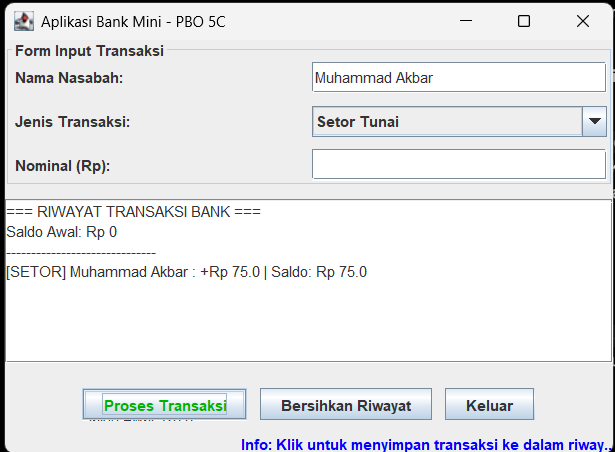
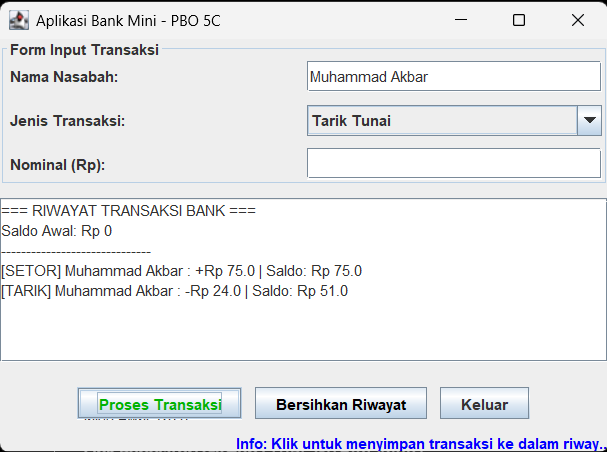
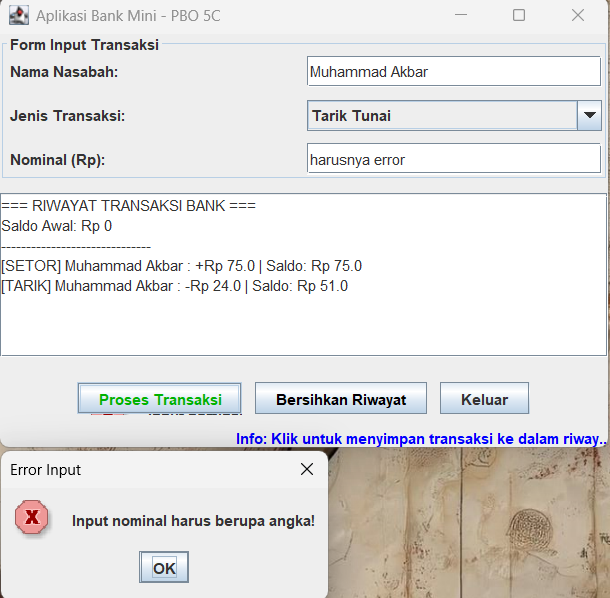
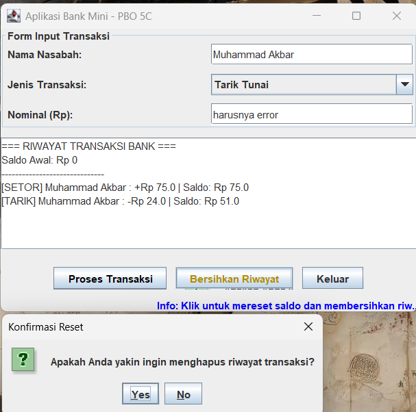
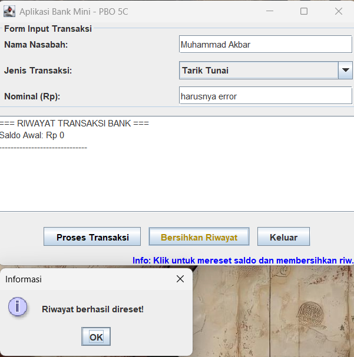

# Tugas GUI Pemrograman Berorientasi Objek (PBO 5C)

- **Nama** : Muhammad Akbar
- **NIM** : F1D02410075
- **Kelas** : PBO 5C

---

## Struktur File Program

Program ini dipisahkan ke dalam 3 file class Java sesuai prinsip _Object-Oriented Programming_ (PBO):

1. **`Nasabah.java`**: Class model yang menyimpan atribut (`nama`, `saldo`) dan method bisnis (`setorTunai`, `tarikTunai`, `resetSaldo`).
2. **`AplikasiBankMini.java`**: Class GUI dan _Event Handler_ yang membangun komponen tampilan serta mengimplementasikan interface `ActionListener` dan `MouseListener`.
3. **`Main.java`**: Class utama (`main`) yang membuat objek `AplikasiBankMini` dan memanggil method `launchFrame()`.

---

## Komponen GUI yang Digunakan

### 1. Top-Level Container

Container dasar tempat komponen-komponen lain diletakkan:

- **`JFrame` (`frame`)**: Digunakan sebagai jendela utama aplikasi dengan pengaturan `EXIT_ON_CLOSE` agar program berhenti sepenuhnya dari memori saat jendela ditutup.
- **`JOptionPane` (Dialog)**: Digunakan untuk menampilkan dialog konfirmasi (`showConfirmDialog`) saat mereset riwayat serta dialog pesan peringatan/informasi (`showMessageDialog`) ketika terjadi kesalahan input.

### 2. Intermediate Container

Container perantara untuk mengelompokkan komponen-komponen GUI:

- **`JPanel` (`panelForm` & `panelTombol`)**: Digunakan untuk mengelompokkan komponen input form di bagian atas dan mengelompokkan tombol aksi di bagian bawah.
- **`JScrollPane` (`scrollRiwayat`)**: Digunakan sebagai wadah bagi `JTextArea` agar daftar riwayat transaksi memiliki _scroll bar_ otomatis saat teks melebihi area tampilan.
- **`Box` (`panelBawah`)**: Container yang secara internal menggunakan `BoxLayout` untuk menyusun panel tombol dan label status secara berurutan dari atas ke bawah (`Y_AXIS`).

### 3. Atomic Component

Komponen spesifik tempat pengguna berinteraksi secara langsung:

- **`JLabel` (`lblNama`, `lblJenis`, `lblNominal`, `lblStatusMouse`)**: Menampilkan teks label form dan informasi interaktif status mouse.
- **`JTextField` (`tfNama`, `tfNominal`)**: Menerima input teks satu baris berupa nama nasabah dan nominal uang dari pengguna.
- **`JComboBox` (`cbJenisTransaksi`)**: Menyediakan pilihan _dropdown_ jenis transaksi ("Setor Tunai" atau "Tarik Tunai").
- **`JButton` (`btnProses`, `btnReset`, `btnKeluar`)**: Tombol untuk mengeksekusi aksi pemrosesan transaksi, penghapusan riwayat, dan penutupan aplikasi.
- **`JTextArea` (`taRiwayat`)**: Menampilkan daftar riwayat transaksi multi-baris.

### 4. Layout Manager

Pengatur tata letak posisi komponen di dalam container:

- **`BorderLayout`**: Diterapkan pada _content pane_ dari `JFrame` (`frame.getContentPane().setLayout(...)`) untuk membagi area menjadi `NORTH` (form input), `CENTER` (riwayat transaksi), dan `SOUTH` (panel tombol dan status).
- **`GridLayout(3, 2, 5, 10)`**: Diterapkan pada `panelForm` untuk menyusun label dan input secara rapi ke dalam 3 baris dan 2 kolom dengan ukuran seragam.
- **`FlowLayout`**: Diterapkan pada `panelTombol` untuk menyusun tombol secara berurutan dari kiri ke kanan dengan perataan tengah (`FlowLayout.CENTER`).
- **`BoxLayout`**: Diterapkan melalui class `Box` dengan sumbu vertikal (`BoxLayout.Y_AXIS`) untuk menumpuk panel tombol dan label status di bagian bawah.

### 5. Event Handling (2 Interface Listener)

Program menerapkan _Delegation Event Model_ dari paket `java.awt.event.*` dengan mengimplementasikan **2 interface listener**:

1. **`ActionListener`**:
   - Mengimplementasikan method `actionPerformed(ActionEvent e)`.
   - Menangani aksi klik pada tombol `btnProses`, `btnReset`, dan `btnKeluar`, serta aksi menekan tombol `<Enter>` saat mengetik di `tfNominal`.
2. **`MouseListener`**:
   - Mengimplementasikan 5 method: `mouseEntered`, `mouseExited`, `mouseClicked`, `mousePressed`, dan `mouseReleased`.
   - Ketika kursor mouse masuk ke area tombol (`mouseEntered`), warna teks tombol berubah dan label status menampilkan panduan fungsi tombol tersebut.
   - Ketika kursor keluar (`mouseExited`), warna tombol kembali normal.
   - Ketika area `taRiwayat` diklik (`mouseClicked`), program menampilkan koordinat X dan Y posisi klik mouse.

---

## Screenshot Program

//coba setor

//coba tarik

//coba error

//coba hapus riwayat

//berhasil hapus riwayat
